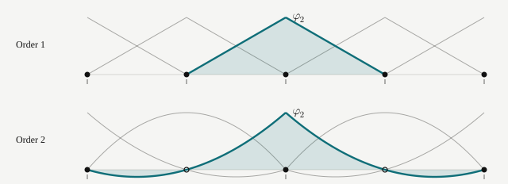

# 3. Elements

Galerkin's method works with any basis. What makes it the *finite element* method is
one specific choice: basis functions that are simple polynomials, and nonzero only
on a few small pieces of the domain
([Courant 1943](20-references.md#courant-1943)).

## Local basis functions make sparse matrices

Split the domain into small cells. Choose basis functions that are zero everywhere
except on the cells touching them.

Now look at a matrix entry like $S_{ij} = \int p\,\phi_i'\phi_j'\,dx$. If $\phi_i$
and $\phi_j$ don't share a cell, their product is zero everywhere, so the entry is
exactly zero. Almost every entry vanishes. That **sparsity** is why FEM can handle
millions of unknowns, and chapter 5 exploits it directly.

## Lagrange elements

On the reference cell $\xi \in [-1, 1]$ (mapped onto real cells below), place
$r + 1$ evenly spaced nodes $\xi_0, \dots, \xi_r$, where $r$ is the polynomial order
($p$ is already the coefficient from chapter 1). The basis function for node $i$ is
the polynomial that equals 1 at node $i$ and 0 at all the other nodes:

$$\ell_i(\xi) = \prod_{j \ne i}\frac{\xi - \xi_j}{\xi_i - \xi_j}$$
<!-- code: H1Line::basis "let node" .. "values[i] *=" -->

A global $\phi_i$ is pieced together from the $\ell$'s of the cells that share node
$i$, so it too is 1 at node $i$ and 0 at every other node. This gives the
coefficients a physical meaning: $u_i$ is just the value of the field at node $i$.

Neighbouring cells share their end node, and that one shared unknown is what makes
the field continuous across the boundary. Continuity is built into the basis.

In [`space.rs`](../crates/glassworks-core/src/space.rs), the numbering is simply
`cell * order + i`. Shared end nodes get the same number automatically, and the
matrix ends up banded, with neighbours close together.
<!-- code: H1Line::cell_dofs -->

This code uses evenly spaced nodes because they're the easiest to understand. They
get badly conditioned at high order, which is one reason order is capped at 5
([Trefethen 2019](20-references.md#trefethen-2019)).

## The reference element

Calculating integrals separately on every cell would be wasteful, since every cell
is just a scaled copy of every other. So we compute once, on the **reference
element** $\xi \in [-1, 1]$, and map to a real cell of length $h$:

$$x = x_0 + \frac{h}{2}(\xi + 1), \qquad dx = \frac{h}{2}\,d\xi, \qquad \frac{d}{dx} = \frac{2}{h}\frac{d}{d\xi}$$

Applying this to the two integrals over one cell $c$, with $i$ and $j$ its local
nodes, the factors of $h$ come out cleanly:

$$(S_c)_{ij} = \int_c \phi_i'\phi_j'\,dx = \frac{2}{h}\int_{-1}^{1}\ell_i'\ell_j'\,d\xi, \qquad (M_c)_{ij} = \int_c \phi_i\phi_j\,dx = \frac{h}{2}\int_{-1}^{1}\ell_i\ell_j\,d\xi$$
<!-- code: H1Line::local_matrices "let h" .. "h / 2.0" -->

That scaling is all `local_matrices` does. In 2D this mapping becomes a Jacobian
matrix, but the idea stays the same.

## Quadrature

The integrals on the reference element are of polynomials, and **Gauss-Legendre
quadrature** computes those exactly ([Davis & Rabinowitz 1984](20-references.md#davis-rabinowitz-1984)):

$$\int_{-1}^{1} g(\xi)\,d\xi \approx \sum_{q=1}^{n} w_q\,g(\xi_q)$$
<!-- code: H1Line::new "gauss_legendre" .. "ref_mass[i * n + j]" -->

$n$ points integrate polynomials up to degree $2n - 1$ exactly. The mass integrand
$\ell_i\ell_j$ has degree $2r$, so $n = r + 1$ points are enough. That's what
`H1Line::new` uses.

## A worked example you can check by hand

Take order $r = 1$. The basis functions on a cell are two straight lines, and the
integrals give

$$S_c = \frac{1}{h}\begin{pmatrix}1 & -1\\-1 & 1\end{pmatrix}, \qquad M_c = \frac{h}{6}\begin{pmatrix}2 & 1\\1 & 2\end{pmatrix}.$$

Consider a cavity of length 1 in vacuum with perfectly conducting walls, so $u = 0$
at both ends and $p = q = 1$. The exact lowest mode has $k_0 = \pi \approx 3.1416$.

Use just two cells, with $h = 1/2$. The two end values are fixed to zero, so only
the middle node remains, and it gets a contribution from each cell:

$$S = \frac{1}{h} + \frac{1}{h} = 4, \qquad M = \frac{2h}{6} + \frac{2h}{6} = \frac{1}{3}.$$

The eigenproblem $S u = k_0^2 M u$ is now just one number, so $k_0^2 = 4 \div \tfrac13 = 12$,
and

$$k_0 = \sqrt{12} \approx 3.4641.$$

A single unknown gets within about 10% of the exact answer, and it comes out above it, as
chapter 2 predicted. The solver returns exactly this value for this mesh:
`3.4641016151`. With four cells it returns `3.2228`, which is 2.6% too high.

## Why higher order is worth it

For smooth fields, raising $r$ reduces the error far faster than shrinking $h$ does
([Babuška et al. 1981](20-references.md#babuska-1981)).
This table is real output from this solver, on the same cavity problem:

| | Unknowns | Error in $k_0^2$ |
|---|---|---|
| $r = 1$, 16 cells | 15 | $3.2 \times 10^{-2}$ |
| $r = 2$, 8 cells | 15 | $3.2 \times 10^{-4}$ |
| $r = 4$, 4 cells | 15 | $5.5 \times 10^{-8}$ |
<!-- code: eigenvalue_error_converges_at_rate_2p "for order in" .. "assert!" -->

All three use 15 unknowns, but the error differs by a factor of about 600,000.
Chapter 8 has the full table.

Next: [assembly and boundary conditions](04-assembly.md).
