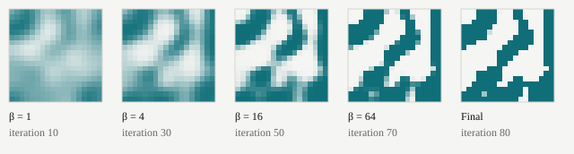

# 13. Inverse design

So far we've analysed structures that someone drew. Instead, we can ask for the structure: state what the light
should do, and let the solver find the shape. This is **topology optimization** ([Bendsøe & Sigmund 2003](20-references.md#bendsoe-sigmund-2003); [Jensen & Sigmund 2011](20-references.md#jensen-sigmund-2011)), and it works because a solver can
report not only an answer, but how that answer changes with every part of the structure, at almost no extra cost.

## Densities

Give each pixel of a region a density $\rho$ between 0 and 1, mixing two materials:

$$\varepsilon = \varepsilon_\text{low} + \rho\,(\varepsilon_\text{high} - \varepsilon_\text{low}).$$
<!-- code: cell_material "let eps" .. "Polarization::Tm" -->

That turns a question about shapes, which can't be differentiated, into a smooth function of hundreds of numbers,
576 for the bend below, which can. We then need a final design that's only 0s and 1s, since a real structure has no grey material. The
rest of this chapter is about the gradient, then about getting from grey to sharp.

The page does this for layers on the **Mirror** and **Broadband coating** views, and in 2D on the **2D waveguide bend**
view under **Inverse design**. Chapter 17 designs a cavity the same way.

## The adjoint method

Hundreds of pixels would take hundreds of solves by finite differences. The **adjoint method** needs one more,
however many pixels there are ([Jensen & Sigmund 2011](20-references.md#jensen-sigmund-2011)).

A monitor's power from chapter 12 is a quadratic form. Writing $\mathrm{Im}\,z = (z - \bar z)/2i$ turns chapter 12's
integral into $P = u^H B\,u$, and $B$ equals its own conjugate transpose: it's Hermitian. Differentiating $Au = f$, where
the source doesn't depend on the structure, a change to the matrix changes the field by $A\,\delta u = -\delta A\,u$, so

$$\delta P = 2\,\mathrm{Re}(u^H B\,\delta u) = -2\,\mathrm{Re}\big(u^H B\,A^{-1}\delta A\,u\big).$$
<!-- code: monitor_power "if index == 0" .. "/ (I * 2.0)" -->

The first step holds because $\delta u^H B\,u$ is the conjugate of $u^H B\,\delta u$ when $B$ is Hermitian.
Computing $A^{-1}\delta A\,u$ for every pixel is exactly the expensive part. But read from the left instead: only the
one row vector $u^H B\,A^{-1}$ is needed, and that's a single solve. Its transpose is $A^{-T}B^T\bar u = A^{-T}\,\overline{B u}$,
because $B^T = \bar B$. Calling that $w$ gives

$$\delta P = -2\,\mathrm{Re}(w^T \delta A\,u), \qquad A^T w = \overline{B\,u}.$$
<!-- code: density_gradient "let mut w = vec" .. "dofs.expand(&w)" -->

One solve for $w$ prices every pixel. It costs even less than that sounds. Chapter 11 noted that $A$ is complex symmetric,
even inside the absorbing layer, so $A^T = A$, and $w$ only needs a back-substitution with the factors we already have. For chapter 11's LDOS,
[chapter 17](17-designing-a-cavity.md) shows that $w = -u/(ik)$, with no solve at all.
For a pixel in $E_z$, $\delta A$ is just $-k_0^2\,\delta\varepsilon$ times its mass matrix, so each pixel's slope is a small
sum over its cells. Chapter 19 does the same for $H_z$, the polarization most planar chips use. `density_gradient_matches_finite_differences` checks this.
<!-- code: pixel_slopes "for cell in 0..space.n_cells()" .. "Polarization::Te =>" -->

## From grey to sharp

The filter, projection and MMA are in [`web/js/optimizer.js`](../web/js/optimizer.js), and [`design.js`](../web/js/design.js) runs the
loop, outside the solver. Only the physics needs to be in Rust.

**Filter.** If every pixel were free, the optimizer would make patterns at the scale of a single pixel, such as
checkerboards, and its designs would change with the mesh ([Bendsøe & Sigmund 2003](20-references.md#bendsoe-sigmund-2003)). A **cone filter** replaces each density by a weighted average of its neighbours, with a weight
falling linearly to zero at a chosen radius ([Andreassen et al. 2011](20-references.md#andreassen-2011)). That sets a smallest feature size. It's linear, so its gradient
is its transpose: the same weights, carrying slopes the other way.
<!-- code: coneFilter2d "const weight" .. "weight / total" -->
<!-- code: coneFilter2d "adjoint(g)" .. "return out" -->

**Projection.** Then push the filtered densities toward 0 or 1 ([Wang et al. 2011](20-references.md#wang-2011)):

$$\hat\rho = \frac{\tanh(\beta/2) + \tanh\big(\beta(\tilde\rho - \tfrac12)\big)}{2\tanh(\beta/2)}.$$
<!-- code: project -->

At small $\beta$ this is nearly a straight line. As $\beta$ grows it becomes a step. Starting with a sharp step would make
the problem nearly impossible, since every pixel's slope would be zero or huge, so $\beta$ doubles in stages, and the
structure sharpens gradually. The slope of $\hat\rho$ joins the chain rule.
<!-- code: optimize "for (const beta of SHARPNESS)" .. "x = mma.step" -->

The optimizer's own variables $x$ are the densities before filtering, so $\tilde\rho = Wx$, where $W$ holds the filter's
weights. A goal $J$ then has the slope

$$\frac{\partial J}{\partial x} = W^T\Big(\hat\rho\,'(\tilde\rho)\odot\frac{\partial J}{\partial\hat\rho}\Big),$$

where $\odot$ multiplies entry by entry. For the bend below, $J$ is minus the mean transmission over three wavelengths, each
a monitor's power divided by a straight guide's at that wavelength. So $\partial J/\partial\hat\rho$ is the adjoint's slope
times $-1/(3P_\text{straight})$, summed over the wavelengths.
<!-- code: goalGradient "-1 / straightPower" .. "return gradient" -->

**Optimizer.** With hundreds of unknowns and an expensive function, a good step matters. The **method of moving asymptotes**
([Svanberg 1987](20-references.md#svanberg-1987)) replaces the objective with a simple convex model for each variable,
built from its slope and two asymptotes on either side, and minimizing that has a closed form. For a variable at $x$,
with slope $g$ and asymptotes $L < x < U$, the model is

$$\frac{P}{U - y} + \frac{Q}{y - L}, \qquad P = (U - x)^2 g^+, \quad Q = (x - L)^2 g^-,$$

with $g^+ = \max(g, 0)$ and $g^- = \max(-g, 0)$, so it has slope $g$ at $x$. Setting its derivative to zero gives

$$y = \frac{\sqrt P\,L + \sqrt Q\,U}{\sqrt P + \sqrt Q}.$$

The code stores $\sqrt P$ and $\sqrt Q$, and then keeps $y$ within $[0, 1]$, within the largest step, and clear of each
asymptote by a tenth of its distance from $x$.
<!-- code: Mma "The model P" .. "next[i] =" -->

A variable that keeps oscillating gets tighter asymptotes, and a steady one gets looser ones. Since projection amplifies
a change in density by up to about $\beta/2$, the largest step allowed shrinks as $\beta$ grows.
<!-- code: Mma "if (prev2)" .. "high[i] = x[i] + 2" -->

**Pixels on cells.** Each pixel should be a whole number of mesh cells, and the solver refuses anything else. If a pixel's
edge runs through a cell, that cell's material depends on where its centre happens to fall. That's a modelling error,
and optimizers are good at exploiting such errors, as the checkerboards above show
([Sigmund & Petersson 1998](20-references.md#sigmund-petersson-1998)). No real structure reproduces them. With pixels on cells, a finished design
is exactly the same matrix as the same shapes drawn by hand.
<!-- code: validate.rs "A pixel edge through" .. "line up with the mesh" -->

### Example: a corner in a slab

Take a slab of index 3.5 and width $0.125\lambda$, with a monitor far along the output. A plain sharp corner passes 23 to 34% of the
light. Now cut out a square one wavelength wide at that corner, which leaves two guides ending at an empty region that passes about
5%, and give that square to the optimizer, with three wavelengths to serve at once
([Jensen & Sigmund 2004](20-references.md#jensen-sigmund-2004) did this kind of thing for photonic crystal bends). A
pattern from a longer run gives:

| Wavelength | Empty region | Sharp corner, 72 cells per $\lambda$ | Optimized, 24 cells per $\lambda$ | Optimized, 48 cells per $\lambda$ |
|---:|---:|---:|---:|---:|
| 0.95 | 5.4% | 23.0% | 97.8% | 97.6% |
| 1.00 | 5.3% | 28.6% | 99.3% | 99.3% |
| 1.05 | 5.5% | 34.2% | 99.4% | 99.6% |
<!-- code: OPTIMIZED_BEND -->
<!-- code: optimized_bend_survives_a_finer_mesh "for wavelength in" .. "let plain" -->

A sharp corner is an easy target, though. The fair comparison is what a designer would draw in that square, a curved bend.
A quarter circle of radius $0.5\lambda$ passes 95.8%, which leaves the optimizer little to gain. So the page sets a tighter
turn. Its guides meet the square a quarter wavelength from its inner corner, where a curved bend has a radius of $0.25\lambda$
and passes 93.2%. Its monitor is also closer to the corner, where it still catches some light radiated from the gap, so its
empty region reads 11.1% and its sharp corner 29.7%. The page runs 10 iterations for each of 8 sharpness stages, and three
random starts reach a mean of 98.3% to 99.2%.
<!-- code: curvedBend -->
<!-- code: design.js "const SHARPNESS" .. "const bendIterations" -->

Because optimizers exploit a model's errors ([Sigmund & Petersson 1998](20-references.md#sigmund-petersson-1998)),
a finished design is worth checking with a model it wasn't optimized on. `optimized_bend_survives_a_finer_mesh` checks
this pattern at twice the resolution, and it holds. Around it, the power entering and leaving a closed loop balances to 0.02%.
The goal asks for three wavelengths at once, as [Christiansen & Sigmund 2021](20-references.md#christiansen-sigmund-2021)
do for a broadband lens, because a design optimized for one can do much worse away from it. Here, a single-wavelength design reached only
43% to 82% at the band's edges.

A real structure's edges also come out slightly wrong. [Chapter 17](17-designing-a-cavity.md#fabrication) shows how to test
that, and how much it matters for a bend and for a cavity.

The structure and its mesh scale with the middle of the band, so 1.9 to 2.1 µm gets the same design as 0.95 to 1.05 µm, at twice the
size. Chapter 12 explains why that's exact.

That completes the essentials: a field, a mesh, a solver, open boundaries, and a design. The next chapters go further, and each stands on its own: [start with whichever interests you](README.md#going-further).

Next: [beyond scalar fields](14-vector-fields.md).
